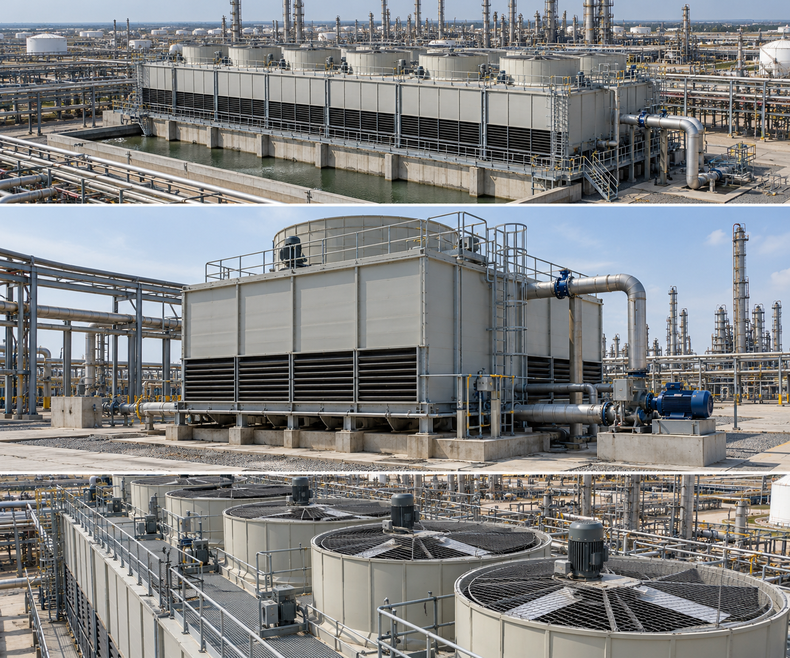
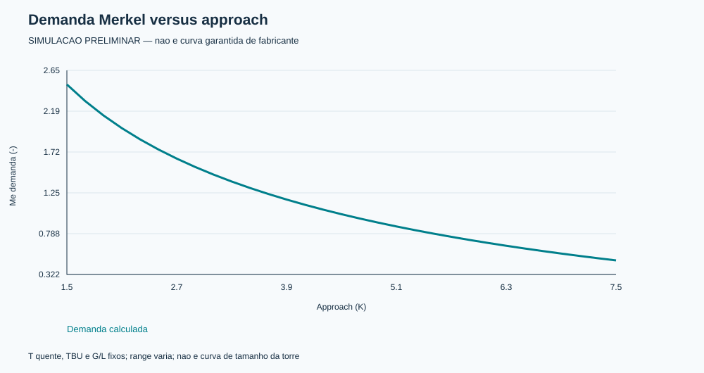
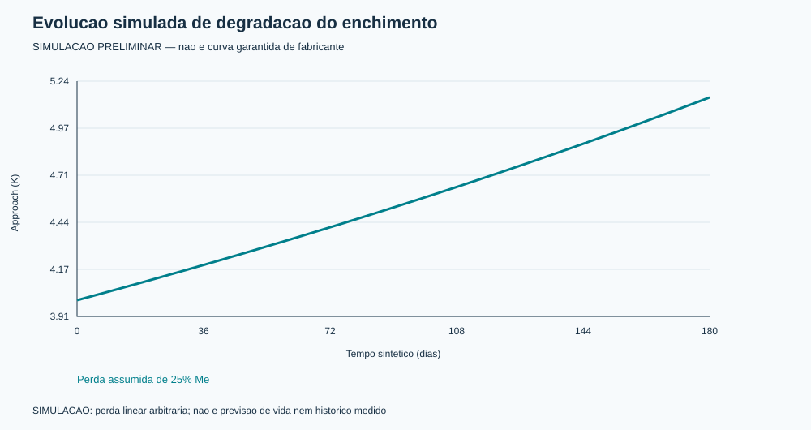

# Industrial Cooling Tower Engineering

**Traceable preliminary calculations, engineering skill, refinery integration guidance and procurement data requirements.**

[Português](docs/README.pt-BR.md) · [Engineering basis](docs/ENGINEERING-BASIS.md) · [Standards register](skills/torres-resfriamento-industriais/references/03-normas-fontes.md) · [Data requirements](docs/DATA-REQUIREMENTS.md) · [Verification](docs/VERIFICATION.md)



*AI-generated conceptual imagery. Not a photograph of a supplied installation, construction drawing, or performance guarantee. The pictured refinery equipment is not a dimensional representation of the 30 m³/h example.*

This repository supports engineers preparing a cooling tower design basis, checking preliminary balances, investigating sensitivities and assembling a technically complete vendor enquiry. It includes a Portuguese Codex skill, an English engineering overview, reusable data registers, a dependency-free Python calculation tool, six SVG charts with CSV data and an offline HTML report.

**Engineering status: preliminary analytical toolkit.** Site-specific thermal selection, fill geometry, fan and pump selection, structural design, sanitary compliance and acceptance require project data, licensed standards where applicable, vendor evidence and responsible engineering review. No claim of industrial certification or completeness for every jurisdiction is made.

## Reference case

| Input/result | Value | Evidence status |
|---|---:|---|
| Water circulation | 30 m³/h | User-supplied example |
| Hot / cold water | 42 / 32 °C | User-supplied example |
| Inlet wet-bulb | 28 °C | User-supplied example |
| Range / approach | 10 / 4 K | Calculated |
| Rejected heat | 348.33 kW | Calculated with ρ=1000 kg/m³, cp=4.18 kJ/(kg K) |
| Dry-air / water mass ratio | 1.5 kg/kg | Assumed, not selected |
| Merkel demand | 1.14752 | Preliminary model, 101.325 kPa, saturated-inlet-enthalpy approximation |
| Reference fan shaft power | 13.61 kW | Assumed 37,500 actual m³/h, 784 Pa and 60% fan efficiency |
| Makeup water | 0.69667 m³/h | All-latent approximation, hfg=2400 kJ/kg, COC=4, drift=0.001% |

The reference air volume is **not derived from the dry-air flow**. Actual fan inlet temperature, humidity, pressure and density must be determined before equipment selection. The attached social-media estimates of fill area are audited rather than adopted.

## Run and reproduce

Python 3.10 or newer; no third-party runtime dependencies.

```bash
python skills/torres-resfriamento-industriais/scripts/calcular.py --self-test
python -m unittest discover -s tests -v
python skills/torres-resfriamento-industriais/scripts/calcular.py --out output
```

Open `output/painel.html` in a browser. Each chart has its underlying CSV, and `resultados.json` records assumptions. The committed example is in [examples/painel.html](examples/painel.html); download/clone the repository to use its local links.

## Performance and evolution charts





Charts cover heat load versus water flow, Merkel demand versus approach, cold-water response to wet-bulb, water use versus concentration cycles, ideal fan affinity laws and synthetic fill degradation. These are calculated scenarios, not measured operating records or manufacturer-certified curves. A historical-data template is included without fabricated observations.

## Conceptual anatomy


The cutaway is illustrative; component dimensions, air arrows and access details must be checked against vendor drawings. Drift eliminators are shown above the distribution system.

## Engineering contents

- [Design basis, psychrometrics, Merkel, water balance and uncertainty](skills/torres-resfriamento-industriais/references/01-base-metodos.md).
- [Refinery integration, fans, pumps, layout, materials and controls](skills/torres-resfriamento-industriais/references/02-refinaria-equipamentos.md).
- [Normative register with applicability and verification status](skills/torres-resfriamento-industriais/references/03-normas-fontes.md).
- [Audit of the supplied calculation and component illustrations](skills/torres-resfriamento-industriais/references/04-exemplo-auditoria.md).
- [Performance curves, operating history and acceptance planning](skills/torres-resfriamento-industriais/references/05-curvas-operacao.md).
- [Calculation report, datasheet, vendor questions and release stages](skills/torres-resfriamento-industriais/references/06-entregaveis.md).
- [Project data requirements and missing-data hold points](docs/DATA-REQUIREMENTS.md).
- [Quality assurance and acceptance responsibilities](docs/QUALITY-PLAN.md).

## Use as a Codex skill

Copy `skills/torres-resfriamento-industriais` into your Codex skills directory. Invoke:

```text
Use $torres-resfriamento-industriais to prepare a preliminary design basis
and vendor enquiry for an induced-draft refinery cooling tower. Separate
provided inputs, assumptions, calculated results and vendor-required evidence.
```

The skill is written in Portuguese; request English outputs when required. Installation does not authorize external actions or replace project approval procedures.

## Evidence, standards and publication boundaries

Public official sources were checked on 2026-10-13. The register distinguishes verified identities/scopes from interfaces whose edition and applicability remain unverified. Paid standards have not been reproduced or represented as fully reviewed. No clause-specific compliance is asserted.

Original third-party attachments are not redistributed. The technical audit paraphrases relevant issues. Generated imagery has prompts and provenance in [assets/prompts.md](skills/torres-resfriamento-industriais/assets/prompts.md).

See [contributing](CONTRIBUTING.md) for calculation changes and [security](SECURITY.md) for handling sensitive project information. No redistribution license is granted in this initial publication; obtain the owner's permission before commercial redistribution or derivative distribution. This repository does not confer rights to referenced standards or third-party materials.
